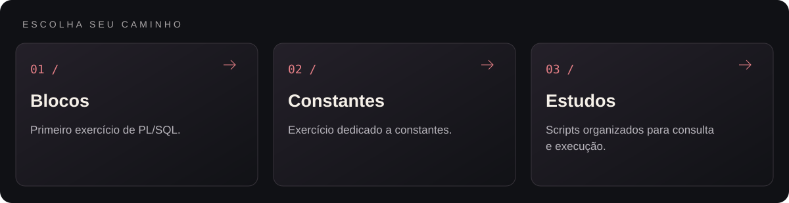
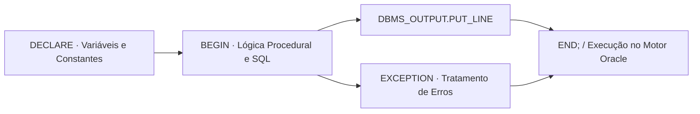

<p align="center">
  
</p>

<p align="center">Exercícios de blocos, variáveis e constantes em programação procedural com Oracle PL/SQL.</p>

<p align="center"></p>

<p align="center"><a href="#visão-geral">Visão geral</a> &nbsp;·&nbsp; <a href="#recursos">Recursos</a> &nbsp;·&nbsp; <a href="#como-executar">Como executar</a></p>

---

<a id="explore-o-projeto"></a>




<table width="100%">
<tr><th align="left">Área</th><th align="left">O que você encontra</th><th align="left">Acesso direto</th></tr>
<tr><td><strong>Blocos</strong></td><td>Primeiro exercício de PL/SQL.</td><td><a href="Begin/Beginning_01.sql">Abrir blocos →</a></td></tr>
<tr><td><strong>Constantes</strong></td><td>Exercício dedicado a constantes.</td><td><a href="Begin/Constants_02.sql">Abrir constantes →</a></td></tr>
<tr><td><strong>Estudos</strong></td><td>Scripts organizados para consulta e execução.</td><td><a href="Begin">Abrir estudos →</a></td></tr>
</table>

<a id="visão-geral"></a>


Este repositório acompanha minha trilha de estudos para a formação **Oracle PL/SQL Specialist** e para as disciplinas de Banco de Dados da faculdade, documentando em scripts comentados a anatomia dos blocos PL/SQL (DECLARE, BEGIN, EXCEPTION, END).

<a id="recursos"></a>


| Script / Tópico | O que exercita |
|---|---|
| Beginning_01.sql | Estrutura fundamental de blocos anônimos, declaração de variáveis numéricas e de texto, atribuição com := e impressão via DBMS_OUTPUT.PUT_LINE. |
| Constants_02.sql | Uso da palavra-chave CONSTANT, imutabilidade de valores em tempo de execução e boas práticas para taxas, limites e parâmetros fixos. |
| Ativação de saída (SET SERVEROUTPUT ON) | Configuração do cliente Oracle SQL Developer / SQL*Plus para captura do buffer de mensagens procedurais. |

<a id="tecnologias"></a>


- **Oracle PL/SQL** para lógica procedural junto ao SGBD;
- **Pacote DBMS_OUTPUT** para inspeção e depuração de variáveis durante a execução dos blocos.

<details>
<summary>Arquitetura de um bloco PL/SQL</summary>



</details>

<details>
<summary>Estrutura do repositório</summary>

```text
PL-SQL-Training/
├── assets/
│   └── banner-v2.png               Banner do projeto
├── Begin/
│   ├── Beginning_01.sql            Blocos anônimos, variáveis e DBMS_OUTPUT
│   └── Constants_02.sql            Declaração e uso de constantes (CONSTANT)
└── README.md
```

</details>

<a id="como-executar"></a>


1. Conecte-se a uma instância **Oracle Database** (local, Docker gvenzl/oracle-xe ou **Oracle Live SQL** no navegador).
2. Habilite a saída do servidor antes de rodar os blocos:
   ```sql
   SET SERVEROUTPUT ON;
   ```
3. Execute os scripts da pasta [Begin/](Begin) no **Oracle SQL Developer**, DBeaver ou SQL*Plus.

---

<p align="center">
  <a href="https://github.com/arthurlynow098">GitHub</a> &nbsp;·&nbsp;
  <a href="https://arthurentsev.vercel.app/">Portfólio</a> &nbsp;·&nbsp;
  <a href="https://www.linkedin.com/in/entsevarthur/">LinkedIn</a>
</p>
